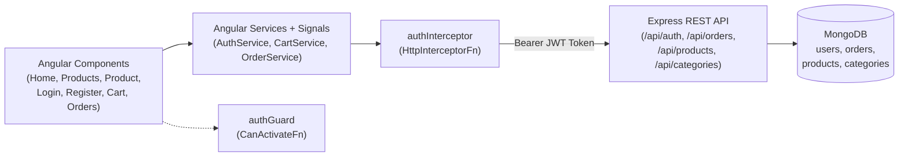

# 📘 Tài Liệu Tham Khảo & Thực Hành Angular — Lab 5 (BHShop)

> **Dự án mẫu:** BHShop — Ứng dụng bán hoa tươi Full-Stack (Angular 22 Standalone + Node.js/Express + MongoDB)  
> **Phạm vi Lab 5:** Đăng ký, Đăng nhập (JWT), Giỏ hàng, Đặt hàng, Quản lý đơn hàng của tôi và các Trạng thái đơn hàng.

---

## 1. Kiến trúc tổng thể sinh viên nắm được



### Cách chạy dự án nhanh để đối chiếu khi học

```bash
# Terminal 1: Chạy Backend (cổng 5000)
npm run backend

# Terminal 2: Chạy Frontend Angular (cổng 4200)
npm start
```

Kiểm tra nhanh API đang hoạt động trên trình duyệt:
- Sản phẩm: `http://localhost:5000/api/products`
- Danh mục: `http://localhost:5000/api/categories`
- Tài khoản: `http://localhost:5000/api/auth`
- Đơn hàng: `http://localhost:5000/api/orders`
- Danh sách trạng thái: `http://localhost:5000/api/orders/statuses`

---

## 2. Sinh viên học được gì từ Angular qua Lab 5?

Dưới đây là **8 trụ cột kiến thức Angular hiện đại** đã được áp dụng trực tiếp trong Lab 5, kèm vị trí file thực tế và bài tập thực hành nhỏ cho từng phần.

---

### Chủ đề 1: Standalone Component & Modern Control Flow (`@if`, `@for`, `@empty`, `@let`)

**Kiến thức học được:**
- Không cần `NgModule` phức tạp: mỗi component khai báo `standalone: true` và tự `imports` đúng những gì nó dùng (`RouterLink`, `FormsModule`, ...).
- Sử dụng cú pháp điều khiển luồng mới của Angular (nhanh hơn, rõ ràng hơn `*ngIf` / `*ngFor` cũ):
  - `@if (...) { ... } @else if (...) { ... } @else { ... }`
  - `@for (item of list(); track item.id) { ... } @empty { ... }`
  - `@let` để tạo biến tạm ngay trong HTML template (giúp template gọn và tránh gọi hàm lặp lại).

**Xem trực tiếp trong dự án:**
- `src/app/components/orders/orders.html` (dùng đủ `@if`, `@for`, `@empty`, `@let`)
- `src/app/components/cart/cart.html`
- `src/app/components/layout/header/header.html`

**Ví dụ minh họa (`orders.html`):**
```html
@for (order of orders(); track order._id) {
  @let meta = statusMap[order.status];
  <span class="status-badge status-{{ order.status }}">
    {{ meta.icon }} {{ meta.label }}
  </span>
} @empty {
  <p>Chưa có đơn hàng nào.</p>
}
```

> **✏️ Bài tập thực hành 1 (15 phút):**  
> Ở trang `src/app/components/products/products.html`, hãy dùng `@if` hiển thị nhãn nhỏ `🔥 Hot` cạnh giá tiền cho những sản phẩm có `product.sold >= 100`, và dùng `@let` tính số tiền tiết kiệm được (nếu có giảm giá).

---

### Chủ đề 2: Quản lý State hiện đại với Angular Signals (`signal`, `computed`, `asReadonly`)

**Kiến thức học được:**
- `signal(initialValue)`: tạo biến trạng thái phản ứng (reactive state). Khi gọi `.set()` hoặc `.update()`, giao diện Angular tự động cập nhật đúng chỗ cần thiết.
- `computed(() => ...)`: tạo dữ liệu dẫn xuất (derived state) — tự động tính lại khi signal phụ thuộc thay đổi, không cần viết hàm gọi tay khắp nơi.
- `.asReadonly()`: đóng gói state trong Service để Component chỉ được **đọc**, muốn thay đổi bắt buộc gọi method của Service (giảm lỗi ghi đè dữ liệu lung tung).

**Xem trực tiếp trong dự án:**
- `src/app/services/cart.service.ts`: `items`, `totalQuantity`, `subtotal`, `shippingFee`, `amountToFreeShipping`, `totalAmount`
- `src/app/services/auth.service.ts`: `isLoggedIn = computed(() => !!this.tokenSignal() && !!this.userSignal())`

**Ví dụ minh họa (`cart.service.ts`):**
```ts
private itemsSignal = signal<CartItem[]>(this.loadCart());
readonly items = this.itemsSignal.asReadonly();

readonly totalQuantity = computed(() =>
  this.itemsSignal().reduce((sum, item) => sum + item.quantity, 0)
);

readonly subtotal = computed(() =>
  this.itemsSignal().reduce((sum, item) => sum + item.unitPrice * item.quantity, 0)
);

readonly shippingFee = computed(() =>
  this.subtotal() === 0 || this.subtotal() >= 300000 ? 0 : 25000
);

readonly totalAmount = computed(() => this.subtotal() + this.shippingFee());
```

> **✏️ Bài tập thực hành 2 (20 phút) — Thêm mã giảm giá (Voucher) bằng Signals:**  
> 1. Trong `CartService`, thêm `voucherCode = signal<string>('')` và `discountAmount = computed(...)`: nếu `voucherCode() === 'HOATUOI10'` thì giảm 10% trên `subtotal()`.  
> 2. Cập nhật `totalAmount = computed(() => this.subtotal() + this.shippingFee() - this.discountAmount())`.  
> 3. Thêm 1 ô input nhập mã giảm giá + nút `Áp dụng` vào `cart.html`.

---

### Chủ đề 3: Dependency Injection (`inject()`) & Service chia sẻ State toàn ứng dụng

**Kiến thức học được:**
- Dùng `@Injectable({ providedIn: 'root' })` tạo Singleton Service dùng chung cho toàn bộ ứng dụng.
- Dùng hàm `inject(CartService)` thay cho `constructor(private cartService: CartService)` gọn gàng, sạch sẽ hơn.
- Hiểu cách nhiều component không có quan hệ cha-con trực tiếp (`Header`, `Home`, `Products`, `ProductComponent`, `Cart`, `App`) đồng bộ dữ liệu theo thời gian thực qua 1 Service chung:
  - Bấm **🛒 Mua** ở `Home` → `CartService` cập nhật → số badge trên `Header` nhảy ngay lập tức + thanh Toast ở `App` hiện thông báo!
- Kết hợp Service với `localStorage` để giữ giỏ hàng và phiên đăng nhập sau khi F5 trình duyệt.

**Xem trực tiếp trong dự án:**
- `src/app/services/cart.service.ts`
- `src/app/components/layout/header/header.ts`
- `src/app/app.ts` & `src/app/app.html`

> **✏️ Bài tập thực hành 3 (25 phút) — Tạo `WishlistService` (Hoa yêu thích):**  
> 1. Tạo `src/app/services/wishlist.service.ts` (`providedIn: 'root'`) chứa `signal<number[]>([])` lưu danh sách `productId` yêu thích vào `localStorage`.  
> 2. Viết các hàm: `toggle(productId)`, `isLiked(productId)`, và `count = computed(...)`.  
> 3. Gắn nút tim `🤍 / ❤️` lên mỗi thẻ sản phẩm ở `home.html` và hiển thị tổng số hoa đã thích trên `header.html`.

---

### Chủ đề 4: Angular Router — Lazy Loading, Route Params, Query Params & `returnUrl`

**Kiến thức học được:**
- **Lazy Loading** từng trang bằng `loadComponent: () => import(...).then(m => m.Component)` giúp giảm dung lượng tải ban đầu (có thể thấy các file chunk riêng khi chạy `npm run build`).
- Phân biệt **Route Param** (`/category/:slug`, `/product/:id`) với **Query Param** (`/products?search=hoa+hong`, `/login?returnUrl=/cart`).
- Điều hướng bằng code với `Router.navigate()` và `Router.navigateByUrl()`.
- Kỹ thuật UX thực tế `returnUrl`: khách bấm "Đặt hàng" khi chưa đăng nhập → chuyển sang `/login?returnUrl=/cart` → đăng nhập xong tự quay lại đúng `/cart` với giỏ hàng vẫn nguyên vẹn.

**Xem trực tiếp trong dự án:**
- `src/app/app.routes.ts`
- `src/app/components/layout/header/header.ts` (tìm kiếm điều hướng sang `/products?search=...`)
- `src/app/components/products/products.ts` (đọc đồng thời `paramMap` và `queryParamMap`)
- `src/app/components/auth/login/login.ts` (đọc `returnUrl`)

> **✏️ Bài tập thực hành 4 (15 phút):**  
> Trên trang `src/app/components/products/products.html`, khi `searchKeyword()` có giá trị, hãy hiển thị 1 dòng thông báo: `Kết quả tìm kiếm cho: "..."` kèm nút `Xóa lọc` gọi `router.navigate(['/products'])` để quay lại toàn bộ danh sách.

---

### Chủ đề 5: Bảo vệ đường dẫn với Functional Route Guard (`CanActivateFn`)

**Kiến thức học được:**
- Route Guard giúp chặn người dùng chưa đăng nhập truy cập vào các trang riêng tư (như `/orders`).
- Dùng cú pháp Functional Guard hiện đại (`CanActivateFn`) thay vì class `implements CanActivate` cũ.
- Trả về `true` để cho phép vào, hoặc `router.createUrlTree(['/login'], { queryParams: { returnUrl: state.url } })` để chuyển hướng an toàn.

**Xem trực tiếp trong dự án:**
- `src/app/guards/auth.guard.ts`
- `src/app/app.routes.ts` (`path: 'orders', canActivate: [authGuard]`)

**Ví dụ minh họa (`auth.guard.ts`):**
```ts
export const authGuard: CanActivateFn = (_route, state) => {
  const authService = inject(AuthService);
  const router = inject(Router);

  if (authService.isLoggedIn()) return true;

  return router.createUrlTree(['/login'], {
    queryParams: { returnUrl: state.url },
  });
};
```

> **✏️ Bài tập thực hành 5 (15 phút) — Viết `guestGuard`:**  
> Tạo `src/app/guards/guest.guard.ts`: nếu `authService.isLoggedIn()` là `true`, không cho vào lại `/login` và `/register` mà tự chuyển hướng sang `/orders`. Gắn `canActivate: [guestGuard]` vào 2 route đó trong `app.routes.ts` và kiểm thử.

---

### Chủ đề 6: `HttpClient`, RxJS & Functional HTTP Interceptor (`HttpInterceptorFn`)

**Kiến thức học được:**
- Gọi đầy đủ các phương thức REST API: `GET`, `POST`, `PUT`, `PATCH` kèm `HttpParams`.
- Dùng toán tử RxJS `tap()` trong `AuthService` để vừa trả `Observable` về cho Component, vừa lưu token/user vào `signal` và `localStorage`.
- Viết **HTTP Interceptor** (`HttpInterceptorFn`) đăng ký tại `app.config.ts` qua `provideHttpClient(withInterceptors([authInterceptor]))`:
  - Tự động gắn header `Authorization: Bearer <token>` cho mọi request gọi lên Backend mà không phải lặp lại code ở từng Service.

**Xem trực tiếp trong dự án:**
- `src/app/interceptors/auth.interceptor.ts`
- `src/app/app.config.ts`
- `src/app/services/order.service.ts`

**Ví dụ minh họa (`auth.interceptor.ts`):**
```ts
export const authInterceptor: HttpInterceptorFn = (req, next) => {
  const token = inject(AuthService).token();
  if (token && req.url.startsWith('http://localhost:5000/api/')) {
    return next(req.clone({
      setHeaders: { Authorization: `Bearer ${token}` },
    }));
  }
  return next(req);
};
```

> **✏️ Bài tập thực hành 6 (20 phút) — Xử lý hết hạn phiên (401) tự động trong Interceptor:**  
> Nâng cấp `auth.interceptor.ts`: dùng `.pipe(catchError((err) => { ... }))` từ `rxjs`. Nếu server trả về `err.status === 401`, tự gọi `authService.logout()`, hiển thị toast `"Phiên đăng nhập đã hết hạn"`, và điều hướng về `/login`.

---

### Chủ đề 7: Xử lý Form, Two-way Binding & Validation (`FormsModule`)

**Kiến thức học được:**
- Import `FormsModule` để sử dụng `[(ngModel)]` (two-way binding) và `(ngSubmit)`.
- Kiểm tra hợp lệ phía client (email đúng định dạng, mật khẩu tối thiểu 6 ký tự, khớp mật khẩu xác nhận, đủ thông tin giao hàng).
- Quản lý trạng thái UX chuẩn thực tế cho form:
  - `isSubmitting = signal(false)` để khóa nút bấm tránh gửi trùng request (`[disabled]="isSubmitting()"`).
  - `errorMessage = signal('')` hiển thị lỗi rõ ràng từ client hoặc từ Backend trả về (`err?.error?.message`).
  - Tự động điền sẵn (pre-fill) thông tin người nhận từ `authService.currentUser()`.

**Xem trực tiếp trong dự án:**
- `src/app/components/auth/login/`
- `src/app/components/auth/register/`
- `src/app/components/cart/` (form thông tin giao hoa + chọn phương thức thanh toán)

> **✏️ Bài tập thực hành 7 (30 phút) — Tạo trang Cập nhật Hồ sơ cá nhân (`/profile`):**  
> Backend đã có sẵn API `PUT /api/auth/profile` và `AuthService` đã có sẵn hàm `updateProfile()`!  
> Hãy tạo component mới `src/app/components/profile/` (bảo vệ bằng `authGuard`) gồm form sửa `fullName`, `phone`, `address`, gọi `authService.updateProfile(...)` và hiện toast khi lưu thành công.

---

### Chủ đề 8: Tư duy TypeScript mạnh (`Union Type`, `Record`, `Interface`) & State Machine cho Trạng thái đơn hàng

**Kiến thức học được:**
- Định nghĩa kiểu chặt chẽ trong `src/app/models/order.ts`:
  - `OrderStatus = 'pending' | 'confirmed' | 'preparing' | 'shipping' | 'delivered' | 'cancelled'`
  - `Record<OrderStatus, OrderStatusMeta>`: ép TypeScript kiểm tra đủ 100% metadata (icon, nhãn, thứ tự bước, trạng thái kế tiếp) cho mọi trạng thái — thiếu 1 trạng thái là báo lỗi ngay lúc biên dịch!
- Vẽ giao diện theo dữ liệu (Data-driven UI):
  - Thanh tab lọc trạng thái + badge đếm số đơn.
  - Thanh tiến trình 5 bước (`PROGRESS_STEPS`) tự highlight bước đã qua (`done`) và bước hiện tại (`current`).
  - Timeline lịch sử chuyển trạng thái (`statusHistory`).

**Xem trực tiếp trong dự án:**
- `src/app/models/order.ts`
- `src/app/components/orders/orders.ts` & `orders.html`

> **✏️ Bài tập thực hành 8 (20 phút) — Tìm kiếm đơn hàng tức thời bằng `computed()`:**  
> Trong `orders.ts`, thêm signal `orderSearch = signal('')` và `filteredOrders = computed(...)` lọc danh sách `orders()` theo `orderCode` hoặc tên sản phẩm trong `order.items`. Gắn 1 ô input tìm kiếm ở phía trên danh sách đơn hàng trong `orders.html`.

---

## 3. Lộ trình tự triển khai lại Lab 5 (Checklist cho sinh viên)

Nếu sinh viên muốn tự code lại Lab 5 từ Lab 4 theo từng bước không bị rối, hãy làm đúng thứ tự sau:

| Bước | Việc cần làm | Kiểm chứng hoàn thành |
|---|---|---|
| **1** | Tạo Model & API Backend `User` + `authRoutes` | Test `POST /api/auth/register`, `POST /api/auth/login`, `GET /api/auth` |
| **2** | Tạo Model & API Backend `Order` + `orderRoutes` | Test `POST /api/orders`, `GET /api/orders/my`, `PATCH /api/orders/:id/status`, `PATCH /api/orders/:id/cancel` |
| **3** | Tạo `models/` (`user.ts`, `cart.ts`, `order.ts`) phía Angular | Không còn kiểu `any` khi gọi API |
| **4** | Tạo `AuthService`, `authInterceptor`, `authGuard` và đăng ký ở `app.config.ts` | Request có tự gắn header `Authorization: Bearer ...` trong tab Network |
| **5** | Tạo trang `Login` và `Register`, cập nhật `Header` | Đăng ký mới → F5 trang vẫn giữ trạng thái đăng nhập → Đăng xuất được |
| **6** | Tạo `CartService` bằng Signals, gắn nút `Mua` ở Home/Products/Product | Thêm sản phẩm → Badge giỏ hàng trên Header tăng + hiện Toast |
| **7** | Hoàn thiện trang `Cart` & Form đặt hàng | Tăng/giảm/xóa món, tính miễn phí ship từ 300.000đ, đặt hàng thành công → giỏ trống |
| **8** | Tạo trang `Orders` bảo vệ bởi `authGuard` | Lọc theo 6 trạng thái, xem chi tiết + timeline, chuyển trạng thái, hủy đơn, mua lại |
| **9** | Chạy `npm run build` | Build production thành công, 0 lỗi TypeScript |

---

## 4. Thử thách nâng cao (Điểm cộng / Đồ án môn học)

Sau khi hoàn thành 8 bài tập nhỏ phía trên, sinh viên có thể thử sức thêm:
1. **Chuyển Form sang Reactive Forms (`FormBuilder`, `Validators`)**: thay thế `FormsModule` ở trang `Register` và `Cart` bằng `ReactiveFormsModule` + hiển thị lỗi chi tiết dưới từng ô input (`touched && invalid`).
2. **Tách trang Chi tiết đơn hàng riêng (`/orders/:id`)**: thay vì mở rộng inline trong danh sách, bấm vào đơn hàng sẽ điều hướng sang trang chi tiết riêng gọi `orderService.getOrderById(id)`.
3. **Phân quyền `role: 'admin'`**: chỉ tài khoản có `role === 'admin'` mới thấy nút cập nhật trạng thái (`pending → confirmed → preparing → shipping → delivered`), còn `customer` chỉ được xem tiến trình và hủy đơn khi còn `pending`/`confirmed`.
4. **Viết Unit Test với Vitest (`npm test`)**: viết test cho `CartService` (kiểm tra cộng dồn số lượng, tính phí ship dưới 300k và trên 300k, xóa sản phẩm).
